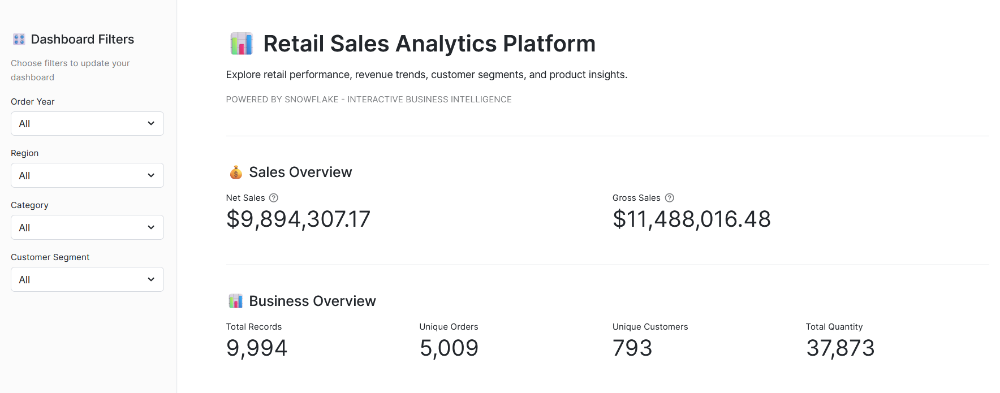
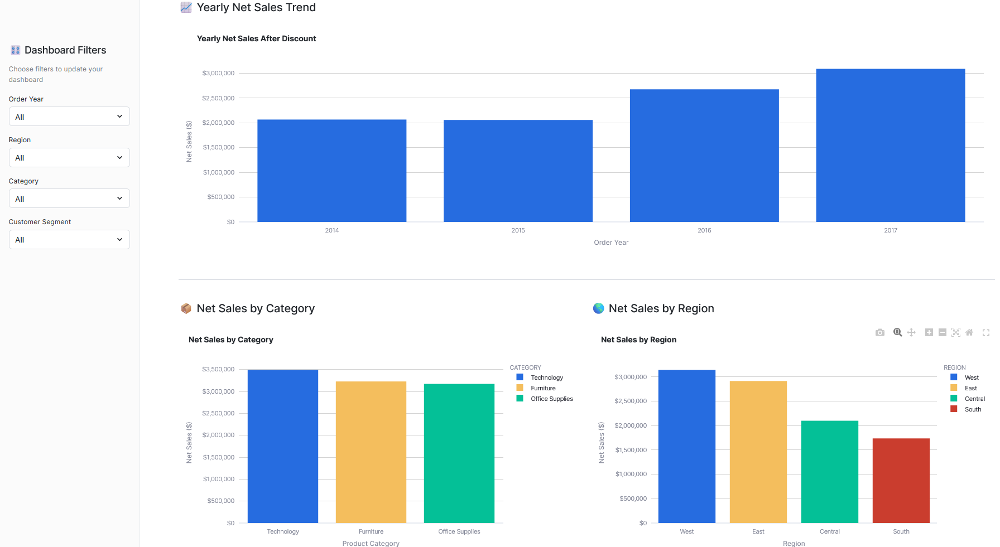
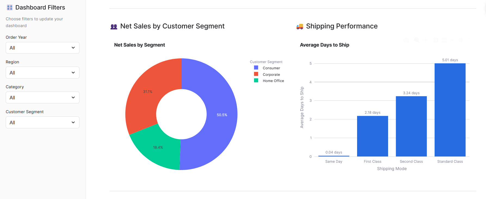
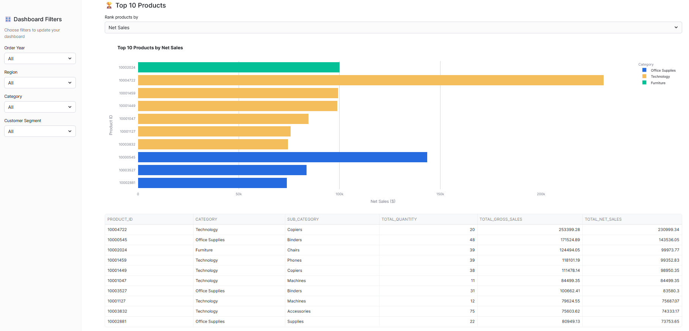

# Retail Sales Analytics Platform

An end-to-end retail sales analytics solution built using **Snowflake, SQL, Snowpark Python, Streamlit, and Plotly**. This project transforms raw retail transaction data into reliable analytical datasets and interactive dashboards to support business decision-making.

## Project Overview

The Retail Sales Analytics Platform analyzes historical retail transactions to identify sales trends, evaluate product and regional performance, understand customer segments, and monitor shipping efficiency.

The solution uses Snowflake for data storage, transformation, and analytics, with Streamlit providing an interactive dashboard.

## Objectives

- Build a structured data pipeline using Snowflake.
- Clean, validate, and deduplicate retail transaction data.
- Calculate gross sales, discount amounts, and net sales.
- Create reusable analytical views.
- Develop an interactive dashboard with Streamlit and Plotly.
- Provide business insights through visual analytics.

## Technology Stack

| Technology | Purpose |
|---|---|
| Snowflake | Cloud data warehouse |
| SQL | Data ingestion, transformation, and analytics |
| Snowpark Python | Python integration with Snowflake |
| Streamlit | Interactive dashboard application |
| Plotly | Data visualization |
| Git & GitHub | Version control and project documentation |

## Architecture


## Snowflake Database Design

**Database:** `RETAIL_SALES_DB`

| Schema | Responsibility |
|---|---|
| RAW | Stores the original imported data |
| TRANSFORM | Stores cleaned and transformed data |
| ANALYTICS | Contains analytical views used by the dashboard |

### Data Processing

1. Loaded the retail dataset into the RAW schema.
2. Transformed the raw records into a structured table.
3. Validated dates, quantities, prices, and discount values.
4. Identified and removed an exact duplicate record.
5. Created analytical views for dashboard reporting.

## Business Metrics

- **Gross Sales:** `PRICE * QUANTITY`
- **Discount Amount:** `PRICE * QUANTITY * DISCOUNT`
- **Net Sales:** `PRICE * QUANTITY * (1 - DISCOUNT)`
- **Shipping Duration:** Difference between shipping date and order date.

## Analytical Views

The analytics schema contains the following seven views:

1. `RETAIL_SALES_VW` – Main analytical dataset.
2. `YEARLY_SALES_VW` – Year-wise sales performance.
3. `CATEGORY_SALES_VW` – Sales by product category.
4. `REGIONAL_SALES_VW` – Regional sales analysis.
5. `SEGMENT_SALES_VW` – Customer segment performance.
6. `SHIPPING_PERFORMANCE_VW` – Shipping duration analysis.
7. `TOP_PRODUCTS_VW` – Top-performing products.

## Dashboard Features

- Interactive filters for order year, region, category, and customer segment.
- KPI cards for net sales, gross sales, records, orders, customers, and quantity.
- Yearly net sales trend.
- Category-wise and region-wise sales analysis.
- Customer segment distribution.
- Average shipping duration analysis.
- Top 10 products with selectable net sales, gross sales, and quantity metrics.

## Data Quality and Validation

The project includes checks for:

- Null values in important business columns.
- Invalid prices and quantities.
- Discounts outside the valid range.
- Incorrect sales calculations.
- Invalid order and shipping dates.
- Duplicate transaction records.

After deduplication, the analytical dataset contains **9,994 records**.

## Future Enhancements

- Automate data processing with Snowflake Streams and Tasks.
- Add sales forecasting and predictive analytics.
- Integrate natural-language analytics.
- Deploy the dashboard for broader business access.

## Repository Structure

```text
Retail_Sales_Analytics_Platform/
│
├── README.md
├── sql/
├── streamlit/
├── screenshots/
└── docs/
```

## Dashboard Screenshots

### 1. Dashboard Overview


### 2. Yearly, Category and Regional Sales Analysis


### 3. Customer Segment and Shipping Performance


### 4. Top 10 Products Analysis



## Dataset Availability

The raw dataset used in this project was provided for learning and project development purposes.

Due to data confidentiality and redistribution restrictions, the original dataset is not included in this public repository.

The SQL scripts and dashboard source code are available for reference. Users can configure their own compatible retail sales dataset to reproduce the analytics workflow.


## Author

**Mathav Ramalingam**

GitHub: [mathav-ramalingam](https://github.com/mathav-ramalingam)

Portfolio: [mathavramalingam](https://mathav-ramalingam.vercel.app/)
