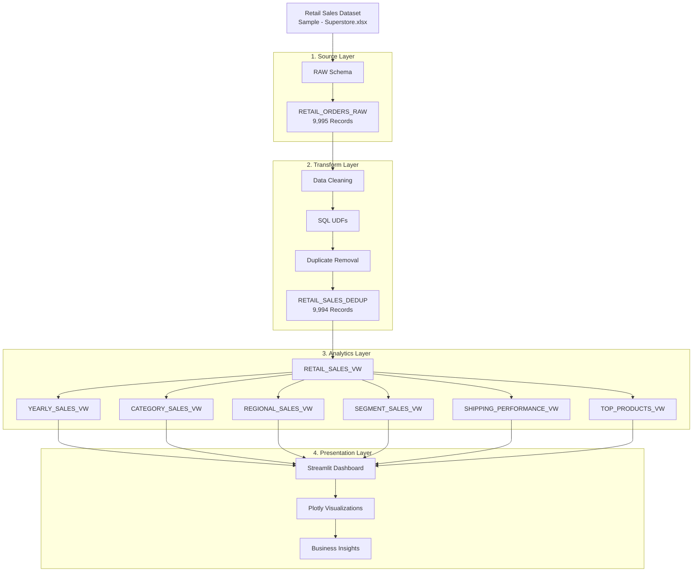

# System Architecture – Retail Sales Analytics Platform

## 1. Overview

The Retail Sales Analytics Platform follows a four-layer architecture designed to transform raw retail transaction data into meaningful business insights.

The four layers are:

1. Source Layer – Raw Data Ingestion
2. Transform Layer – Data Cleaning and Processing
3. Analytics Layer – Analytical Views
4. Presentation Layer – Interactive Dashboard

## 2. Architecture Diagram



## 3. Architecture Layers

### Layer 1 – Source Layer

**Schema:** `RETAIL_SALES_DB.RAW`

Purpose:
- Store the original retail transaction dataset.
- Upload CSV data through the Snowflake Snowsight interface.
- Preview and validate imported records.

Main table:

`RETAIL_ORDERS_RAW`

Records: 9,995

### Layer 2 – Transform Layer

**Schema:** `RETAIL_SALES_DB.TRANSFORM`

Purpose:
- Clean and transform raw retail records.
- Convert identifiers into numeric values.
- Calculate shipping duration and sales.
- Validate business rules.
- Remove exact duplicate records.

Six SQL UDFs were created:

- `GET_DAYS_TO_SHIP`
- `GET_CUSTOMER_ID`
- `GET_ORDER_ID`
- `GET_PRODUCT_ID`
- `GET_ORDER_YEAR`
- `GET_SALES`

Main deduplicated table:

`RETAIL_SALES_DEDUP`

Records: 9,994

### Layer 3 – Analytics Layer

**Schema:** `RETAIL_SALES_DB.ANALYTICS`

The main analytical view is:

`RETAIL_SALES_VW`

It reads the cleaned and deduplicated records from the TRANSFORM layer.

Six additional analytical views provide business-level summaries:

| View | Purpose |
|---|---|
| YEARLY_SALES_VW | Year-wise sales analysis |
| CATEGORY_SALES_VW | Category-wise sales analysis |
| REGIONAL_SALES_VW | Regional sales analysis |
| SEGMENT_SALES_VW | Customer segment analysis |
| SHIPPING_PERFORMANCE_VW | Shipping duration analysis |
| TOP_PRODUCTS_VW | Top 10 products by net sales |

### Layer 4 – Presentation Layer

**Technology:** Streamlit and Plotly

The Streamlit dashboard connects to Snowflake using:

`get_active_session()`

Dashboard capabilities:

- Interactive sidebar filters.
- Net sales and gross sales KPIs.
- Yearly sales trends.
- Category and regional analysis.
- Customer segment distribution.
- Shipping performance analysis.
- Top 10 product rankings.

## 4. Data Flow

1. The retail dataset is uploaded into the RAW schema.
2. Data is cleaned and transformed in the TRANSFORM schema.
3. Exact duplicate records are removed.
4. The main analytical view is created in the ANALYTICS schema.
5. Six additional views aggregate business metrics.
6. Streamlit retrieves data from Snowflake and presents interactive visualizations.

## 5. Database Structure

```text
RETAIL_SALES_DB
│
├── RAW
│   └── RETAIL_ORDERS_RAW
│
├── TRANSFORM
│   ├── RETAIL_SALES_CLEAN
│   ├── RETAIL_SALES_CLEAN_BACKUP
│   ├── RETAIL_SALES_DEDUP
│   └── SQL UDFs
│
└── ANALYTICS
    ├── RETAIL_SALES_VW
    ├── YEARLY_SALES_VW
    ├── CATEGORY_SALES_VW
    ├── REGIONAL_SALES_VW
    ├── SEGMENT_SALES_VW
    ├── SHIPPING_PERFORMANCE_VW
    └── TOP_PRODUCTS_VW
```

## 6. Implementation Notes

- Snowflake is used for cloud data storage and analytical processing.
- SQL UDFs provide reusable transformation logic.
- Analytical views separate reporting logic from dashboard presentation.
- Streamlit provides the interactive user interface.
- Plotly is used for charts and visualizations.
- Streams and Tasks are not implemented in the current version and are considered future enhancements.
